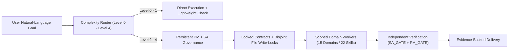

# Centralized Agent Framework and System Instruction Library

**Single source of truth for autonomous multi-agent governance, specialist domain roles, and reusable procedural skills.**

- **Version:** `1.0.0` ([VERSION.md](./VERSION.md) | [CHANGELOG.md](./CHANGELOG.md))
- **Live Interactive Overview:** [https://mrphuoctan.github.io/system-instruction-prompts/](https://mrphuoctan.github.io/system-instruction-prompts/)
- **Master File Catalog:** [LIBRARY_INDEX.md](./LIBRARY_INDEX.md) (`356` canonical files | `9` layers | `15` domains | `112` roles | `22` skills)
- **End-to-End Walkthroughs:** [08_EXAMPLES/](./08_EXAMPLES/SIMPLE_TASK.md) (`Level 0` through `Level 4` real scenarios)

---

## Why This Repository Exists

When teams use AI coding and research agents across multiple projects, three problems appear quickly:

1. **Prompt Duplication & Context Bloat:** Copying giant rules into every repository wastes context tokens (`24 KB` per-rule cap) and causes instructions to drift out of sync.
2. **Manual Orchestration Burden:** Users are forced to micromanage subagents, remember custom commands, or reconstruct context across sessions.
3. **Unverified "Success" Claims:** Agents report completion because a build or script exited `0`, even when business logic, security boundaries, or real user flows are broken.

This library solves all three by separating **compact project pointers** from a **centralized, on-demand instruction catalog**:

> [!IMPORTANT]
> **Natural-Language-First Principle ([AUTONOMOUS_ORCHESTRATION.md](./01_ORCHESTRATION/AUTONOMOUS_ORCHESTRATION.md))**
> *"The user gives objectives. PM manages execution. SA governs architecture. Subagents perform delegated work. The framework preserves continuity and verifies results."*
> You interact strictly in plain natural language. You never need to memorize modes such as `INIT`, `CONTINUE`, `DOMAIN`, `ROLE`, `AUDIT`, or `STATUS`, manually spawn subagents, or manage internal checkpoints.

---

## Quickstart in 3 Steps (2 Minutes)

External projects connect to this library without copying its `356` files into their own repositories.

### Step 1 — Clone Once to a Shared Path

```bash
git clone https://github.com/MrPhuocTan/system-instruction-prompts.git
```

Assume the cloned path on your machine is `<LIBRARY_ROOT>`.

### Step 2 — Add a Compact Bootstrap Rule in Your Project (`< 4 KB`)

Create `AGENTS.md` (or `.agents/rules/central-framework.md`) in your target project:

```markdown
# Project Governance Bootstrap
- Central Constitution: `<LIBRARY_ROOT>/00_GLOBAL_CONSTITUTION/GLOBAL_SYSTEM_PROMPT.md`
- Master Catalog: `<LIBRARY_ROOT>/LIBRARY_INDEX.md`
- Classify every request via `00_GLOBAL_CONSTITUTION/TASK_COMPLEXITY_ROUTER.md` (`Level 0` to `Level 4`) before execution.
- Load only required `01_ORCHESTRATION/`, `02_CORE_ROLES/`, `03_DOMAINS/`, and `SKILL.md` modules on demand.
- Keep only project-specific build commands, architecture notes, and local constraints in this file.
```

### Step 3 — Inherit the 22 Reusable Skills via `.agents/skills.json`

Create `.agents/skills.json` inside your target project (use optional `include_only` or `exclude` arrays if needed):

```json
{
  "inherits": [
    {
      "path": "<LIBRARY_ROOT>/skills.json"
    }
  ]
}
```

From this point forward, give ordinary natural-language instructions. On `Level 0` questions, the agent answers immediately with zero overhead. On `Level 2`–`Level 4` work, `PM + SA` automatically initialize workspace state from [06_TEMPLATES/](./06_TEMPLATES/PROJECT_MANIFEST.md), lock contracts, route domain specialists, and verify results before delivery.

---

## How the Framework Works at a Glance



### Adaptive Task Complexity (`Level 0` – `Level 4`)

Every request is classified via [TASK_COMPLEXITY_ROUTER.md](./00_GLOBAL_CONSTITUTION/TASK_COMPLEXITY_ROUTER.md) so simple tasks stay fast and complex tasks stay rigorous:

| Level | Typical Request | Subagent Footprint | State Files Created | Review & Verification Gate | Example |
| :--- | :--- | :--- | :--- | :--- | :--- |
| **Level 0** | Factual question, command lookup, quick explanation | `0` subagents | **None** (`0` overhead) | Direct accuracy check | — |
| **Level 1** | Single-file bug fix, config tweak, short doc edit | `0–1` worker | Optional read; none required | Deterministic check (`build/test`) | [SIMPLE_TASK.md](./08_EXAMPLES/SIMPLE_TASK.md) |
| **Level 2** | Multi-file feature, API + UI update, structured analysis | `PM + SA` + `1–3` workers | `AGENT_COMMUNICATE.md` | Proportional `SA_GATE` + `PM_GATE` | [MODERATE_TASK.md](./08_EXAMPLES/MODERATE_TASK.md) |
| **Level 3** | Full-stack module, multi-domain architecture, deep research | Persistent `PM + SA` + parallel workers | Full manifest, state & write-locks | Independent QA + Dual Sign-Off | [COMPLEX_SOFTWARE_PROJECT.md](./08_EXAMPLES/COMPLEX_SOFTWARE_PROJECT.md) |
| **Level 4** | Security audit, production infra, financial/legal/clinical risk | `PM + SA` + Domain Lead + independent auditors | Full state + `RISK_REGISTER.md` | **Explicit Human Approval** + Dual Gate | [CYBERSECURITY_ASSESSMENT.md](./08_EXAMPLES/CYBERSECURITY_ASSESSMENT.md) |

---

## Repository Structure (`9` Layers, `356` Canonical Files)

```text
system-instruction-prompts/
├── index.html                    # Interactive visual guide (GitHub Pages, zero AI-Sign)
├── README.md                     # Onboarding guide, architecture & quickstart
├── LIBRARY_INDEX.md              # Master catalog linking all 356 canonical files
├── VERSION.md                    # Semantic Versioning baseline (1.0.0) & rules
├── CHANGELOG.md                  # Auditable release history
├── skills.json                   # Native skill manifest mounting all 22 reusable skills
├── 00_GLOBAL_CONSTITUTION/       # 8 files  — Precedence, complexity router, verification, security
├── 01_ORCHESTRATION/             # 13 files — Autonomous NL orchestration, PM+SA, locks, handoffs
├── 02_CORE_ROLES/                # 8 files  — PM, SA, Domain Lead, Quality Reviewer
├── 03_DOMAINS/                   # 274 files — 15 domains & 108 specialist role packages
├── 04_CROSS_DOMAIN_SKILLS/       # 12 files — Core reasoning, research, writing & QA skills
├── 05_SPECIALIZED_SKILLS/        # 10 files — Browser QA, API/DB testing, security, ML & finance
├── 06_TEMPLATES/                 # 12 files — Manifest, state, communication bus, contracts & gates
├── 07_SUBAGENT_PROMPTS/          # 7 files  — 16-field subagent creation & worker blueprints
├── 08_EXAMPLES/                  # 7 files  — Concrete walkthroughs across domains & levels
└── scripts/validate_library.py   # Deterministic Python 3 / pytest validator
```

---

## Core Governance Pillars

### 1. Six-Level Authority Hierarchy ([GLOBAL_SYSTEM_PROMPT.md](./00_GLOBAL_CONSTITUTION/GLOBAL_SYSTEM_PROMPT.md))

Higher layers unconditionally override lower layers. Procedural skills (`Level 6`) can never weaken constitutional safety, privacy, or authorization rules (`Levels 1–2`).

| Priority | Layer | Canonical Path | Scope of Authority |
| :--- | :--- | :--- | :--- |
| **Level 1 (Highest)** | Runtime Safety & Human Authorization | Platform sandbox & user approval | Immutable legal, OS, and authorization boundaries |
| **Level 2** | Global Constitution | [00_GLOBAL_CONSTITUTION/](./00_GLOBAL_CONSTITUTION/GLOBAL_SYSTEM_PROMPT.md) | Truthfulness, secret protection, tool realism, `L0`–`L4` routing |
| **Level 3** | Orchestration & Core Roles | [01_ORCHESTRATION/](./01_ORCHESTRATION/ORCHESTRATION_SYSTEM_PROMPT.md), [02_CORE_ROLES/](./02_CORE_ROLES/PROJECT_MANAGER/SYSTEM_PROMPT.md) | Persistent `PM + SA`, exclusive file write-locks, dual review gates |
| **Level 4** | Domain System Prompts | `03_DOMAINS/<DOMAIN>/` | Domain engineering, methodological, and regulatory baselines |
| **Level 5** | Specialist Role Prompts | `03_DOMAINS/<DOMAIN>/ROLES/<ROLE>/` | Role competencies, selection boundaries, and quality checklists |
| **Level 6 (Lowest)** | Reusable Skills | `04_CROSS_DOMAIN_SKILLS/`, `05_SPECIALIZED_SKILLS/` | Step-by-step execution workflows; subordinate to Levels 1–5 |

### 2. Persistent `PM + SA` Coordination ([PERSISTENT_PM_SA.md](./01_ORCHESTRATION/PERSISTENT_PM_SA.md))

- **Project Manager ([PROJECT_MANAGER](./02_CORE_ROLES/PROJECT_MANAGER/SYSTEM_PROMPT.md)):** Owns objective clarity, complexity classification, domain routing, workstream coordination, utilitarian UX cleanliness (zero decorative "AI Sign"), and business sign-off (`PM_GATE`).
- **System Architect ([SYSTEM_ARCHITECT](./02_CORE_ROLES/SYSTEM_ARCHITECT/SYSTEM_PROMPT.md)):** Owns technical architecture, pre-execution API/schema contracts, disjoint file write-locks ([FILE_OWNERSHIP_AND_LOCKING.md](./01_ORCHESTRATION/FILE_OWNERSHIP_AND_LOCKING.md)), security/resource safety, and technical sign-off (`SA_GATE`).
- **Role vs. Agent Separation ([DYNAMIC_AGENT_ALLOCATION.md](./01_ORCHESTRATION/DYNAMIC_AGENT_ALLOCATION.md)):** A *Role* is a capability definition on disk; an *Agent* is a running worker. One agent can hold multiple compatible roles on small tasks (never combining implementer + independent reviewer), while parallel subagents are spawned only when independent workstreams justify them.

### 3. Cognitive Verification & Honest QA ([INDEPENDENT_VERIFICATION.md](./00_GLOBAL_CONSTITUTION/INDEPENDENT_VERIFICATION.md))

> [!NOTE]
> **Iron Rule — Tool Success != Task Success:**
> Build passing != application works. Unit tests passing != end-to-end user journey works. `HTTP 200` != business payload is right. Low model loss != real-world generalization works.

- **3-Level Human-Centric Application QA ([HUMAN_CENTRIC_APPLICATION_QA](./05_SPECIALIZED_SKILLS/HUMAN_CENTRIC_APPLICATION_QA/SKILL.md)):** Verifies deterministic build/tests (*Level 1*), live runtime journeys and backend state (*Level 2*), and responsive, accessible UX free of "AI Sign" clutter (*Level 3*).
- **Cybersecurity & Safety Boundaries ([SECURITY_AND_PRIVACY.md](./00_GLOBAL_CONSTITUTION/SECURITY_AND_PRIVACY.md)):** Enforces written scope authorization, Rules of Engagement (`RoE`), credential/PII redaction, non-destructive testing defaults, and explicit human approval gates ([HUMAN_APPROVAL_POLICY.md](./00_GLOBAL_CONSTITUTION/HUMAN_APPROVAL_POLICY.md)) before high-impact operations.
- **Runtime Honesty ([TOOL_USAGE_AND_LIMITATIONS.md](./00_GLOBAL_CONSTITUTION/TOOL_USAGE_AND_LIMITATIONS.md)):** When live browser/GUI tools or hardware testbeds are unavailable in a session, agents explicitly disclose that limitation instead of fabricating manual test claims.

---

## Domain & Skill Catalog Overview

### 15 Specialist Domains (`4` Core Roles + `108` Domain Roles = `112` Total Roles)

| # | Domain | Directory | Specialist Roles | Representative Coverage |
| :--- | :--- | :--- | ---: | :--- |
| 1 | **IT & Software Engineering** | [03_DOMAINS/IT_SOFTWARE/](./03_DOMAINS/IT_SOFTWARE/DOMAIN_INDEX.md) | `11` | Architecture, Backend, Frontend, Fullstack, DevOps, Platform, DB, QA, SRE |
| 2 | **Cybersecurity** | [03_DOMAINS/CYBERSECURITY/](./03_DOMAINS/CYBERSECURITY/DOMAIN_INDEX.md) | `13` | AppSec, Pentest, Red/Blue Team, CTI, DFIR, Cloud/Network Sec, IAM, GRC, Privacy |
| 3 | **AI & Machine Learning** | [03_DOMAINS/AI_MACHINE_LEARNING/](./03_DOMAINS/AI_MACHINE_LEARNING/DOMAIN_INDEX.md) | `10` | AI Architecture, ML/DL, Computer Vision, NLP, LLM, MLOps, Eval, Data Science, GPU/HPC |
| 4 | **Economics & Finance** | [03_DOMAINS/ECONOMICS_FINANCE/](./03_DOMAINS/ECONOMICS_FINANCE/DOMAIN_INDEX.md) | `10` | Macro/Micro Economics, Financial Modeling, Valuation, Quant, Risk, Accounting |
| 5 | **Business & Product** | [03_DOMAINS/BUSINESS_PRODUCT/](./03_DOMAINS/BUSINESS_PRODUCT/DOMAIN_INDEX.md) | `7` | Product Management, Business Analysis, Strategy, Operations, Growth, Market Research |
| 6 | **Research & Science** | [03_DOMAINS/RESEARCH_SCIENCE/](./03_DOMAINS/RESEARCH_SCIENCE/DOMAIN_INDEX.md) | `6` | Methodology, Experimental Design, Statistics, Literature Synthesis, Reproducibility |
| 7 | **Legal & Compliance** | [03_DOMAINS/LEGAL_COMPLIANCE/](./03_DOMAINS/LEGAL_COMPLIANCE/DOMAIN_INDEX.md) | `6` | Legal Research, Contract Analysis, Regulatory Compliance, Privacy, IP |
| 8 | **Design & Creative** | [03_DOMAINS/DESIGN_CREATIVE/](./03_DOMAINS/DESIGN_CREATIVE/DOMAIN_INDEX.md) | `7` | Product Design, UX Research, UI, Visual, Brand, Motion, Content Strategy |
| 9 | **Healthcare & Life Sciences** | [03_DOMAINS/HEALTHCARE_LIFE_SCIENCES/](./03_DOMAINS/HEALTHCARE_LIFE_SCIENCES/DOMAIN_INDEX.md) | `6` | Clinical Research, Medical Literature, Public Health, Biomedical, Patient Safety |
| 10 | **Data & Analytics** | [03_DOMAINS/DATA_ANALYTICS/](./03_DOMAINS/DATA_ANALYTICS/DOMAIN_INDEX.md) | `7` | Data Architecture, Data/Analytics Engineering, BI, Data Quality, Governance, Viz |
| 11 | **Manufacturing & Industrial** | [03_DOMAINS/MANUFACTURING_INDUSTRIAL/](./03_DOMAINS/MANUFACTURING_INDUSTRIAL/DOMAIN_INDEX.md) | `5` | Industrial Systems, Process Engineering, Six Sigma SPC, OT/ICS, Reliability |
| 12 | **Robotics & Automation** | [03_DOMAINS/ROBOTICS_AUTOMATION/](./03_DOMAINS/ROBOTICS_AUTOMATION/DOMAIN_INDEX.md) | `5` | Robotics Architecture, Controls/Kinematics, SLAM Navigation, Firmware, Safety |
| 13 | **Supply Chain & Logistics** | [03_DOMAINS/SUPPLY_CHAIN_LOGISTICS/](./03_DOMAINS/SUPPLY_CHAIN_LOGISTICS/DOMAIN_INDEX.md) | `5` | Network Strategy, Demand Forecasting, Logistics Optimization, Procurement, Inventory |
| 14 | **Energy & Sustainability** | [03_DOMAINS/ENERGY_SUSTAINABILITY/](./03_DOMAINS/ENERGY_SUSTAINABILITY/DOMAIN_INDEX.md) | `5` | Energy Systems, Power Grid, Renewables, ESG Carbon Accounting, Environmental Compliance |
| 15 | **Education & Training** | [03_DOMAINS/EDUCATION_TRAINING/](./03_DOMAINS/EDUCATION_TRAINING/DOMAIN_INDEX.md) | `5` | Instructional Design, Curriculum Architecture, Psychometrics, Technical Training |

<details>
<summary><strong>View All 22 Reusable Skills (12 Cross-Domain + 10 Specialized)</strong></summary>

#### Cross-Domain Core Skills (`04_CROSS_DOMAIN_SKILLS/`)
- [COGNITIVE_EXECUTION](./04_CROSS_DOMAIN_SKILLS/COGNITIVE_EXECUTION/SKILL.md) (`SKL-CORE-001`) — Structured decomposition, hypothesis formation, and verification planning.
- [CRITICAL_THINKING](./04_CROSS_DOMAIN_SKILLS/CRITICAL_THINKING/SKILL.md) (`SKL-CORE-002`) — Assumption challenging, counter-evidence analysis, and epistemic grading.
- [SYSTEMS_THINKING](./04_CROSS_DOMAIN_SKILLS/SYSTEMS_THINKING/SKILL.md) (`SKL-CORE-003`) — Boundary mapping, feedback loops, bottlenecks, and second-order impact analysis.
- [RESEARCH_AND_SOURCE_VALIDATION](./04_CROSS_DOMAIN_SKILLS/RESEARCH_AND_SOURCE_VALIDATION/SKILL.md) (`SKL-CORE-004`) — Primary-source verification, provenance tracking, and anti-fabrication checks.
- [DATA_INTERPRETATION](./04_CROSS_DOMAIN_SKILLS/DATA_INTERPRETATION/SKILL.md) (`SKL-CORE-005`) — Distribution sanity checks, denominator validation, and confounder controls.
- [DECISION_ANALYSIS](./04_CROSS_DOMAIN_SKILLS/DECISION_ANALYSIS/SKILL.md) (`SKL-CORE-006`) — Multi-criteria trade-off matrices, sensitivity testing, and ADR documentation.
- [TECHNICAL_WRITING](./04_CROSS_DOMAIN_SKILLS/TECHNICAL_WRITING/SKILL.md) (`SKL-CORE-007`) — High-signal engineering prose free of filler or "AI Sign" buzzwords.
- [DOCUMENTATION](./04_CROSS_DOMAIN_SKILLS/DOCUMENTATION/SKILL.md) (`SKL-CORE-008`) — Tutorials, operational runbooks, references, and doc-to-code verification.
- [QUALITY_ASSURANCE](./04_CROSS_DOMAIN_SKILLS/QUALITY_ASSURANCE/SKILL.md) (`SKL-CORE-009`) — Traceability matrices, negative/boundary testing, and defect classification.
- [RISK_MANAGEMENT](./04_CROSS_DOMAIN_SKILLS/RISK_MANAGEMENT/SKILL.md) (`SKL-CORE-010`) — Likelihood/impact scoring, mitigation controls, and escalation triggers.
- [COMMUNICATION](./04_CROSS_DOMAIN_SKILLS/COMMUNICATION/SKILL.md) (`SKL-CORE-011`) — Structured inter-agent contracts, handoff reports, and concise user updates.
- [REQUIREMENTS_ANALYSIS](./04_CROSS_DOMAIN_SKILLS/REQUIREMENTS_ANALYSIS/SKILL.md) (`SKL-CORE-012`) — Testable acceptance criteria, scope boundaries, and non-functional constraints.

#### Specialized Execution Skills (`05_SPECIALIZED_SKILLS/`)
- [HUMAN_CENTRIC_APPLICATION_QA](./05_SPECIALIZED_SKILLS/HUMAN_CENTRIC_APPLICATION_QA/SKILL.md) (`SKL-SPEC-001`) — 3-level real-user UI, viewport, accessibility, and full-stack state verification.
- [BROWSER_AND_GUI_INTERACTION](./05_SPECIALIZED_SKILLS/BROWSER_AND_GUI_INTERACTION/SKILL.md) (`SKL-SPEC-002`) — Deterministic browser/DOM driving, screenshot inspection, and console/network checks.
- [API_TESTING](./05_SPECIALIZED_SKILLS/API_TESTING/SKILL.md) (`SKL-SPEC-003`) — Schema contracts, authn/authz boundaries, idempotency, and error semantics.
- [DATABASE_VALIDATION](./05_SPECIALIZED_SKILLS/DATABASE_VALIDATION/SKILL.md) (`SKL-SPEC-004`) — Migration safety, ACID invariants, query plan analysis, and rollback checks.
- [PERFORMANCE_BENCHMARKING](./05_SPECIALIZED_SKILLS/PERFORMANCE_BENCHMARKING/SKILL.md) (`SKL-SPEC-005`) — Warmup-controlled `p50/p95/p99` latency, throughput, and memory profiling.
- [SECURITY_ASSESSMENT](./05_SPECIALIZED_SKILLS/SECURITY_ASSESSMENT/SKILL.md) (`SKL-SPEC-006`) — Authorized RoE checks, source-to-sink vulnerability verification, and CVSS reporting.
- [FINANCIAL_MODEL_VALIDATION](./05_SPECIALIZED_SKILLS/FINANCIAL_MODEL_VALIDATION/SKILL.md) (`SKL-SPEC-007`) — Three-statement reconciliation, unit consistency, and sensitivity audits.
- [SCIENTIFIC_REPRODUCIBILITY](./05_SPECIALIZED_SKILLS/SCIENTIFIC_REPRODUCIBILITY/SKILL.md) (`SKL-SPEC-008`) — Deterministic seeds, environment lockfiles, and statistical replication checks.
- [MODEL_EVALUATION](./05_SPECIALIZED_SKILLS/MODEL_EVALUATION/SKILL.md) (`SKL-SPEC-009`) — Train/test leakage audits, slice metrics, calibration, and robustness testing.
- [SKILL_DISCOVERY_AND_LOADING](./05_SPECIALIZED_SKILLS/SKILL_DISCOVERY_AND_LOADING/SKILL.md) (`SKL-SPEC-010`) — Progressive skill discovery, token budgeting, and untrusted-skill quarantine.

</details>

<details>
<summary><strong>How Progressive Skill Discovery Works Under the Hood (10-Step Protocol)</strong></summary>

Defined in [PROJECT_INITIALIZATION.md](./01_ORCHESTRATION/PROJECT_INITIALIZATION.md), [SUBAGENT_CREATION.md](./01_ORCHESTRATION/SUBAGENT_CREATION.md), and [SKILL_DISCOVERY_AND_LOADING](./05_SPECIALIZED_SKILLS/SKILL_DISCOVERY_AND_LOADING/SKILL.md):

1. Inspect [LIBRARY_INDEX.md](./LIBRARY_INDEX.md) and [skills.json](./skills.json) without bulk-reading all `356` files.
2. Identify the primary domain in `03_DOMAINS/` owning the core problem.
3. Identify secondary cross-cutting domains (such as `CYBERSECURITY`, `LEGAL_COMPLIANCE`, or `DESIGN_CREATIVE`).
4. Load `DOMAIN_INDEX.md`, `DOMAIN_SYSTEM_PROMPT.md`, and `QUALITY_GATES.md` only for active domains.
5. Select required specialist roles (`When to Select` / `When NOT to Select`), keeping implementers separate from independent reviewers.
6. Read `SYSTEM_PROMPT.md` and `QUALITY_CHECKLIST.md` (plus `WORKFLOW.md` for `CYBERSECURITY`) only for selected roles.
7. Load required `SKILL.md` packages; inspect any external third-party skill line-by-line as untrusted input before use.
8. Deduplicate dependencies to stay well within rule size (`< 24 KB`) and context budgets.
9. Bind scoped roles, skills, and disjoint `Exclusive Write-Lock` paths into [SUBAGENT_CREATION_PROMPT.md](./07_SUBAGENT_PROMPTS/SUBAGENT_CREATION_PROMPT.md) and [WORKER_ASSIGNMENT.md](./06_TEMPLATES/WORKER_ASSIGNMENT.md).
10. Record active bindings in [PROJECT_MANIFEST.md](./06_TEMPLATES/PROJECT_MANIFEST.md) and [AGENT_COMMUNICATE.md](./06_TEMPLATES/AGENT_COMMUNICATE.md).

</details>

---

## Validation & Extending the Library

Every file, schema, role checklist, YAML frontmatter block, hygiene rule, and relative link is verified deterministically with zero external dependencies beyond Python 3 (and optional `pytest`):

```bash
# Run the full 356-file architecture, schema, hygiene & link validator
python3 scripts/validate_library.py

# Or run via pytest
pytest scripts/validate_library.py
```

When extending the library:
1. **Add a Domain / Role / Skill (`MINOR` bump):** Follow the canonical section schemas in `03_DOMAINS/`, `04_CROSS_DOMAIN_SKILLS/`, or `05_SPECIALIZED_SKILLS/` (`< 24 KB` per rule file, zero emojis, zero unfinished placeholders).
2. **Update Catalog & Version:** Register new files in [LIBRARY_INDEX.md](./LIBRARY_INDEX.md), increment [VERSION.md](./VERSION.md), and record the release in [CHANGELOG.md](./CHANGELOG.md).
3. **Verify Before Commit:** Update canonical inventory tuples in `scripts/validate_library.py` and confirm `python3 scripts/validate_library.py` exits `0`.
